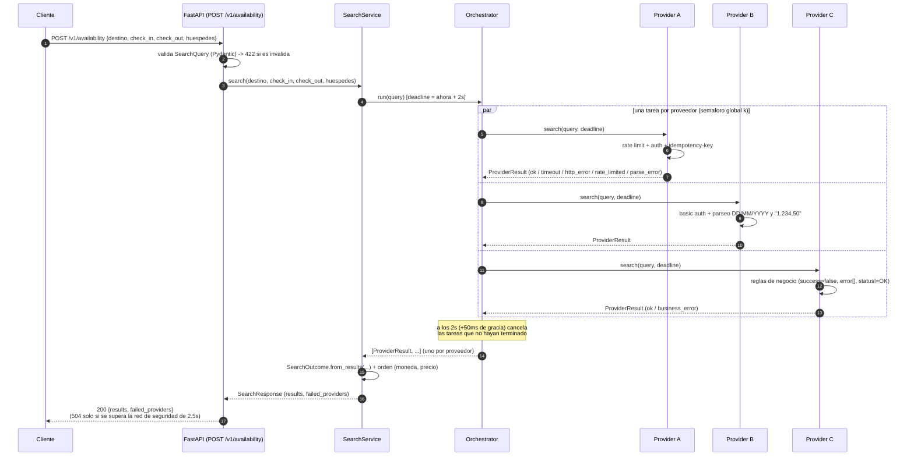

# availability_hotel

API REST (FastAPI) que consulta en paralelo la disponibilidad y tarifas de varios
proveedores hoteleros y devuelve una respuesta estandarizada con los que
respondieron dentro del presupuesto de 2 s. Constitucion: [plan.md](plan.md);
historias de usuario: [docs/hu/README.md](docs/hu/README.md).

## Requisitos

- [uv](https://docs.astral.sh/uv/) (instala Python 3.15.0 segun `.python-version`).
- Docker + Docker Compose para el entorno local completo.

## Comandos estandar (HU-S01)

```bash
uv sync                                   # entorno reproducible desde uv.lock
uv run black --check .                    # formato black por defecto
uv run ruff check .                       # PEP8 (reglas E, W, F)
uv run pytest --cov --cov-fail-under=90   # pruebas + cobertura minima 90 %
uv run pre-commit install                 # hook de black + ruff en cada commit
```

Detras de un proxy corporativo con TLS interceptado: `export UV_SYSTEM_CERTS=1`.

## Ejecucion con Docker (HU-S02)

```bash
docker compose up -d --build              # app + mocks A/B/C + LocalStack
API=localhost:$(docker compose port app 8000 | cut -d: -f2)   # puerto real publicado (8000 por defecto)
curl $API/health
curl -X POST $API/v1/availability \
  -H 'content-type: application/json' \
  -d '{"destino":"BOG","check_in":"2026-11-01","check_out":"2026-11-03","huespedes":2}'
docker compose down
```

Si el `8000` del host esta ocupado (por ejemplo por otro proyecto), Compose publica
el servicio igual pero en otro puerto solo si lo fijas: `APP_PORT=8080
LOCALSTACK_PORT=4567 docker compose up -d --build`. `docker compose port app 8000`
siempre devuelve el puerto real publicado, sea cual sea `APP_PORT`; usalo en vez de
asumir `8000` a ciegas, porque un `curl` contra el puerto equivocado responde `404`
(de otro servicio del host), no un error de conexion.

Otras verificaciones:

```bash
docker build -t availability-hotel .                 # imagen runtime (por defecto)
docker run --rm availability-hotel id -u             # 10001 (no root)
docker build --target dev -t availability-hotel:dev . && docker run --rm availability-hotel:dev
```

## Ejecucion local sin Docker para la app

```bash
LOCALSTACK_PORT=4566 docker compose up -d localstack   # Secrets Manager local + secretos
uv run python -m mocks                                 # mocks A/B/C en 9001/9002/9003
APP_ENV=local AWS_ENDPOINT_URL=http://localhost:4566 \
  uv run uvicorn availability_hotel.main:app --port 8000
```

Variables de entorno: `APP_ENV` (`local`|`prod`, obligatoria), `AWS_ENDPOINT_URL`
(obligatoria en local), `AWS_DEFAULT_REGION`, `AWS_ACCESS_KEY_ID`,
`AWS_SECRET_ACCESS_KEY` (por defecto `us-east-1`/`test`/`test` en local),
`PROVIDERS_CONFIG` (por defecto `config/providers.toml`), `LOG_LEVEL`, `PORT`,
`PROVIDER_{A,B,C}_BASE_URL`.

## API (HU008)

| Metodo | Ruta | Respuesta |
| --- | --- | --- |
| `POST` | `/v1/availability` | `200` con `results` y `failed_providers`; `422` si la consulta es invalida o trae campos extra; `503` si la configuracion fallo; `504` si se supera la red de seguridad de 2.5 s |
| `GET` | `/health` | `200` listo, `503` configuracion de proveedores invalida |

`/docs` y `/openapi.json` solo se exponen cuando `APP_ENV != prod`.

## Flujo de una consulta

El controlador (`controllers/api.py`) valida la entrada y delega en `SearchService`,
que arma la `SearchQuery` y se la pasa al `Orchestrator`. Este dispara una llamada
por proveedor **en paralelo** (una tarea `asyncio` cada una, con un semaforo global
como limite de concurrencia) contra un deadline comun de 2 s; a quien no responda a
tiempo se le cancela con 50 ms de gracia (RNF-02). Cada proveedor resuelve su propia
autenticacion, rate limit y mapeo de su formato nativo a `Rate`/error, de forma
independiente de los demas. El servicio ordena las tarifas (`moneda`, `precio`),
arma `failed_providers` con los que no aportaron resultados y siempre responde
`200` si la consulta en si era valida.



## Mocks de proveedores

No hay APIs reales: cada proveedor es un servidor HTTP generico
([mocks/server.py](mocks/server.py)) que sirve archivos JSON de
`mocks/data/<proveedor>/` con el formato nativo de ese proveedor:

| Proveedor | Formato nativo | Escenario por defecto |
| --- | --- | --- |
| A | `GET /v1/availability`, JSON plano (`offers[].total_price`), API key + `idempotency-key`, 10 req/s con 429 | `ok` (250 ms) |
| B | `POST /api/v2/disponibilidad`, arbol `Respuesta.Hoteles.Hotel[].Habitaciones.Habitacion[].Tarifas.Tarifa[]`, montos `1.234,50`, fechas `DD/MM/YYYY`, sin impuestos, basic auth | `slow` (3000 ms, p95) |
| C | `POST /hotels/search`, `data.results[]`, errores de negocio en HTTP 200 | `ok` (400 ms) |

Cada escenario declara `latency_ms` (numero o `{"min", "max"}`), `status`,
`headers` y `body`/`raw_body`. El body admite placeholders `{{body.ruta}}` y
`{{query.param}}` (por ejemplo, B devuelve las fechas de la estadia pedida).
`_provider.json` declara la autenticacion esperada, los headers obligatorios y el
rate limit propio del mock.

Cambiar escenario sin reconstruir:

```bash
MOCK_SCENARIO_B=ok MOCK_LATENCY_MS_C=1500 docker compose up -d       # al arrancar
curl -X PUT localhost:9002/_mock/scenario -H 'content-type: application/json' \
  -d '{"scenario":"ok","latency_ms":1500}'                          # en caliente
curl localhost:9001/_mock/scenarios                                  # disponibles
curl localhost:9001/_mock/requests                                   # requests recibidos
```

## Como estimular cada respuesta

Cada mock tiene su propio puerto y su propio escenario, asi que se puede fijar el
escenario de **un solo proveedor** sin tocar los otros: A en `9001`, B en `9002`,
C en `9003` (los mismos puertos con `docker compose` y con `uv run python -m mocks`).
El escenario cambiado queda activo para todas las consultas siguientes hasta que
se vuelva a cambiar.

Atajos de shell (`API` toma el puerto real publicado por Compose; si corres sin
Docker usa `API=localhost:8000` o el valor de `PORT`):

```bash
API=localhost:$(docker compose port app 8000 | cut -d: -f2)
Q='{"destino":"BOG","check_in":"2027-03-10","check_out":"2027-03-12","huespedes":2}'
buscar()    { curl -s -w '  [HTTP %{http_code} %{time_total}s]\n' -X POST $API/v1/availability \
                -H 'content-type: application/json' -d "${1:-$Q}"; }
escenario() { curl -s -X PUT localhost:$1/_mock/scenario -H 'content-type: application/json' \
                -d "{\"scenario\":\"$2\"${3:+,\"latency_ms\":$3}}"; echo; }  # puerto escenario [latencia]
defecto()   { escenario 9001 ok; escenario 9002 slow; escenario 9003 ok; }
```

Ejemplo completo sin atajos (A con error 503 y luego de vuelta a `ok`; ajusta
`8000` si tu `APP_PORT` es otro, o confirma el real con `docker compose port app 8000`):

```bash
curl -X PUT localhost:9001/_mock/scenario -H 'content-type: application/json' -d '{"scenario":"server_error"}'
curl -X POST localhost:8000/v1/availability -H 'content-type: application/json' \
  -d '{"destino":"BOG","check_in":"2027-03-10","check_out":"2027-03-12","huespedes":2}'
curl -X PUT localhost:9001/_mock/scenario -H 'content-type: application/json' -d '{"scenario":"ok"}'
```

Reglas utiles para leer la respuesta:

- Siempre es `200` mientras la consulta sea valida, aunque fallen todos los
  proveedores; los fallos van en `failed_providers[].reason`
  (`timeout`, `rate_limited`, `business_error`, `http_error`, `parse_error`).
- Un proveedor que responde bien pero sin ofertas **no** aparece en
  `failed_providers`.
- `results` va ordenado por `(currency, price)`: las tarifas COP de B salen antes
  que las USD. Los precios de B incluyen 19 % de IVA calculado por la API.
- El corte es de 2 s: con B en `slow` (por defecto) cada consulta tarda ~2 s.

### Linea base (escenarios por defecto: A `ok`, B `slow`, C `ok`)

| Que quieres ver | Preparar | Respuesta esperada de `buscar` |
| --- | --- | --- |
| Respuesta por defecto | `defecto` | `200`, 7 resultados USD (4 de A, 3 de C), `failed_providers=[{provider_b, timeout}]`, ~2 s |
| Los tres proveedores responden | `escenario 9002 ok` | `200`, 11 resultados (4 COP de B: 542.52, 1166.20, 1469.06, 1664.81; luego 7 USD), `failed_providers=[]`, ~1.2 s |
| Sin disponibilidad en ningun proveedor | `escenario 9001 empty; escenario 9002 empty; escenario 9003 no_availability` | `200`, `{"results":[],"failed_providers":[]}` |
| Todos fallan | `escenario 9001 server_error; escenario 9003 invalid_key` (B ya da timeout) | `200`, `results=[]`, A `http_error`, B `timeout`, C `business_error` |

En las tablas siguientes, salvo lo indicado, el resto se queda en su escenario por
defecto, por lo que `failed_providers` incluye ademas `{provider_b, timeout}`.

### Proveedor A (puerto 9001)

| Escenario | Preparar | Lo que cambia en la respuesta |
| --- | --- | --- |
| `ok` (defecto) | `escenario 9001 ok` | 4 ofertas USD de A (89.50, 119.00, 132.40 `HC-004`/`TWN`, 245.99) |
| `empty` | `escenario 9001 empty` | Sin ofertas de A y A no figura en `failed_providers` |
| `slow` (1.5 s) | `escenario 9001 slow` | 1 oferta de A (`Hotel Central`, 119.00), llega antes del corte |
| `timeout` (3 s) | `escenario 9001 timeout` | `{provider_a, timeout}` |
| Latencia forzada | `escenario 9001 ok 2500` | `{provider_a, timeout}` aunque el escenario sea `ok` |
| `rate_limited` (429) | `escenario 9001 rate_limited` | `{provider_a, rate_limited}`; durante 1 s (`Retry-After`) A sigue en `rate_limited` sin llamarse, aunque vuelvas a `ok` |
| `auth_error` (401) | `escenario 9001 auth_error` | `{provider_a, http_error}` |
| `idempotency_conflict` (409) | `escenario 9001 idempotency_conflict` | `{provider_a, http_error}` |
| `server_error` (503) | `escenario 9001 server_error` | `{provider_a, http_error}` |
| `invalid_json` (200 con HTML) | `escenario 9001 invalid_json` | `{provider_a, parse_error}` |

### Proveedor B (puerto 9002)

| Escenario | Preparar | Lo que cambia en la respuesta |
| --- | --- | --- |
| `slow` (defecto, 3 s) | `escenario 9002 slow` | `{provider_b, timeout}` |
| `ok` (1.2 s) | `escenario 9002 ok` | 4 ofertas COP de B; 2 tarifas del mock se descartan (sin importe, fecha invalida) |
| `empty` | `escenario 9002 empty` | `failed_providers=[]`, sin ofertas de B |
| `spike` (8 s) | `escenario 9002 spike` | `{provider_b, timeout}` |
| `variable` (0.8 a 3.5 s) | `escenario 9002 variable` | Aleatorio: unas veces 4 ofertas COP, otras `{provider_b, timeout}` |
| `auth_error` (401) | `escenario 9002 auth_error` | `{provider_b, http_error}` |
| `server_error` (500) | `escenario 9002 server_error` | `{provider_b, http_error}` |

### Proveedor C (puerto 9003)

| Escenario | Preparar | Lo que cambia en la respuesta |
| --- | --- | --- |
| `ok` (defecto) | `escenario 9003 ok` | 3 ofertas USD de C (98.40, 156.00, 201.75 `C-79`/`FAM`) |
| `slow` (1.5 s) | `escenario 9003 slow` | 1 oferta de C (`Hotel Bacata`, 98.40) |
| `empty` | `escenario 9003 empty` | Sin ofertas de C, C no figura en `failed_providers` |
| `no_availability` (`NO_AVAILABILITY` en 200) | `escenario 9003 no_availability` | Igual que `empty`: no es un fallo |
| `invalid_dates` | `escenario 9003 invalid_dates` | `{provider_c, business_error}` |
| `invalid_destination` | `escenario 9003 invalid_destination` | `{provider_c, business_error}` |
| `invalid_key` | `escenario 9003 invalid_key` | `{provider_c, business_error}` |
| `internal_error` | `escenario 9003 internal_error` | `{provider_c, business_error}` |
| `unknown_code` | `escenario 9003 unknown_code` | `{provider_c, business_error}` |
| `errors_list` (`errors[]` con `success=true`) | `escenario 9003 errors_list` | `{provider_c, business_error}` |
| `error_with_results` | `escenario 9003 error_with_results` | `{provider_c, business_error}`; las tarifas que trae se ignoran |
| `http_500` | `escenario 9003 http_500` | `{provider_c, http_error}` |
| `empty_body` (200 sin body) | `escenario 9003 empty_body` | `{provider_c, parse_error}` |

### Respuestas que no dependen de los mocks

| Que quieres ver | Llamado | Respuesta esperada |
| --- | --- | --- |
| `422` check_in en el pasado | `buscar '{"destino":"BOG","check_in":"2020-01-01","check_out":"2020-01-03","huespedes":2}'` | `check_in debe ser mayor o igual a hoy` |
| `422` check_out no posterior | `buscar '{"destino":"BOG","check_in":"2027-03-12","check_out":"2027-03-10","huespedes":2}'` | `check_out debe ser posterior a check_in` |
| `422` mas de 30 noches | `buscar '{"destino":"BOG","check_in":"2027-03-01","check_out":"2027-04-01","huespedes":2}'` | `la estadia no puede superar 30 noches` |
| `422` campo extra | `buscar '{"destino":"BOG","check_in":"2027-03-10","check_out":"2027-03-12","huespedes":2,"x":1}'` | `extra_forbidden` en `body.x` |
| `422` huespedes fuera de rango o como texto | `huespedes` en `0`, `11` o `"2"` | `greater_than_equal` / `less_than_equal` / `int_type` |
| `422` destino vacio, campo faltante o fecha mal formada | `"destino":"  "`, sin `check_out`, `"check_in":"10/03/2027"` | `string_too_short` / `missing` / `date_from_datetime_parsing` |
| `503` configuracion invalida | `docker compose run -d --rm --no-deps -p 8081:8000 -e PROVIDERS_CONFIG=/app/no-existe.toml --name ah-503 app`, luego `curl localhost:8081/health` y `API=localhost:8081 buscar`; al terminar `docker rm -f ah-503` | `/health`: `503 {"status":"not_ready",...}`; busqueda: `503 configuracion de proveedores invalida; servicio no listo` |
| `504` red de seguridad | No se puede provocar con los mocks: el orquestador corta a los 2 s (+50 ms) y la red es de 2.5 s | Solo cubierto por pruebas unitarias |

### Volver al estado por defecto

- En caliente: `defecto` (o `PUT` con `ok` en 9001 y 9003 y `slow` en 9002). Un
  `PUT` sin `latency_ms` quita la latencia forzada.
- Si arrancaste con variables (`MOCK_SCENARIO_B=ok docker compose up -d`), un
  `PUT` posterior manda sobre ellas, pero al reiniciar el contenedor vuelven a
  aplicarse. Para quitarlas: `docker compose up -d` sin esas variables (recrea los mocks).
- `curl localhost:900X/_mock/health` muestra el escenario activo de cada mock.

El header `X-Mock-Scenario` solo sirve llamando directo al mock; la API no lo
reenvia a los proveedores.

## Estructura (MVC)

```text
config/providers.toml            configuracion declarativa (sin secretos)
src/availability_hotel/
    main.py                      app FastAPI + lifespan
    models/                      SearchQuery, Rate, ProviderResult, SearchOutcome
    views/                       SearchResponse y render_search (body HTTP)
    controllers/                 router HTTP, SearchService, Orchestrator, runtime
    providers/                   BaseProvider, auth, registro, reglas de negocio,
                                 adaptadores A/B/C
    config/                      settings de entorno, schema, loader, Secrets Manager
    core/                        logging JSON, rate limit, extraccion por ruta/parsers
mocks/                           servidor mock + escenarios JSON por proveedor
docker/                          entrypoint y script de secretos de LocalStack
tests/unit, tests/integration
```

## Decisiones tomadas en la implementacion

Preguntas abiertas de las HU resueltas con la opcion mas alineada al plan; quedan
pendientes de aprobacion en el loop de revision.

- **HU-S01**: el criterio de bloqueo RF-09/RF-10/RF-11 se valido: niquests 3.21.2,
  fastapi 0.153.0, uvicorn[standard] 0.54.0 y pydantic 2.14.1 instalan y funcionan
  sobre Python 3.15.0; starlette resuelve a 1.9.0. Para `TestClient` se usa
  `httpx2` (dev) porque starlette depreca `httpx`.
- **HU-S02**: imagen base fijada por etiqueta y digest (P-01). Mocks como servidor
  Python propio en el repo (P-02). Puertos del host configurables. Un error de
  entorno (`APP_ENV`, `AWS_ENDPOINT_URL`) aborta con codigo 3; un error de
  configuracion de proveedores deja la app arriba con `/health` en 503 (HU008).
- **HU-S03**: TOML (P-01), pydantic (P-04), recarga solo con reinicio (P-03). Se
  agrega expansion `${VAR:-defecto}` en strings para variar URLs por entorno.
- **HU-S04**: `logging` estandar con formateador JSON propio y `QueueHandler`
  (P-01, P-02). El `correlation_id` tambien viaja al proveedor en `X-Correlation-ID`.
- **HU001**: destino como texto libre/IATA (P-01); maximo 30 noches y 10 huespedes
  (P-02); sin conversion de moneda (P-03); sin deduplicacion (P-04). Orden DC-01:
  `sorted` por `(moneda, precio)`.
- **HU002**: registro por decorador + lista explicita de imports (P-01); payload
  parcial: se descartan solo las ofertas invalidas (P-02); `map_response` recibe
  JSON (P-03).
- **HU003**: DC-01 y DC-02 implementados como se propusieron; k = 1000 (P-04);
  sin reintentos (P-01); el corte de 2 s incluye el mapeo (P-03); el orquestador
  cancela con 50 ms de gracia sobre el corte de cada proveedor (margen P-02).
- **HU004 (DC-01 requiere aprobacion)**: el token bucket propuesto puede enviar
  hasta 2x la cuota en una ventana deslizante, lo que incumple RNF-02 y el criterio
  "no mas de 10 en ningun segundo". Por defecto se usa **ventana deslizante con log
  acotado** (O(1) amortizado, O(requests) memoria) y el token bucket queda
  disponible con `rate_limit.algorithm = "token_bucket"` (admite `burst`). Las
  pruebas contra el mock mostraron que el jitter de conexion comprime la rafaga en
  el servidor, por eso A usa `safety_margin_s = 0.1`. DC-02: se espera cupo hasta
  el deadline; con `Retry-After` vigente se rechaza de inmediato sin enviar.
- **HU005**: header `x-api-key` (P-01), contrato del mock como especificacion
  (P-03), precios con impuestos en USD (P-04), costo 0.005 por request (P-05),
  409/422 como `IDEMPOTENCY` (P-06).
- **HU006**: tasa unica por proveedor (P-04), `ROUND_HALF_UP` (P-05); formatos de
  fecha `%d/%m/%Y` y `%Y%m%d` y montos `.`/`,` declarados en configuracion; las
  fechas de cada tarifa deben coincidir con la estadia pedida.
- **HU007**: reglas declarativas (`success == false`, `error`/`errors` no vacios,
  `status != OK`) aplicadas por `BaseProvider` a cualquier proveedor con
  `business_errors`; si hay error y tarifas prevalece el error (P-06).
- **HU008**: sin batch (P-02), sin autenticacion de consumidores (P-04), 1 worker
  (P-05), sin `TrustedHostMiddleware` (P-06). Red de seguridad de 2.5 s con `504`.
