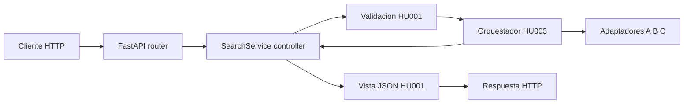

# HU008 - Servicio de consulta y API HTTP

| Campo | Valor |
| --- | --- |
| Estado | En revision |
| Version | 0.4 |
| Tipo | Funcional |
| Dependencias | HU001, HU003 |

## Historia

**Como** consumidor externo o interno de la plataforma
**Quiero** ejecutar una consulta de disponibilidad a traves de una API HTTP construida con FastAPI
**Para** integrar la solucion de punta a punta en la fase 1 sin acoplarme a un cliente especifico

## Contexto

La fase 1 expone una API HTTP (FastAPI) como unico punto de entrada. El controlador MVC (`SearchService`) es un servicio asincrono invocado directamente por los endpoints; FastAPI y Pydantic se suman como dependencias fijadas en [HU-S01](HU-S01-proyecto-base.md), validadas por compatibilidad con Python 3.15.0 (ver tabla de versiones en esa HU).



## Requisitos funcionales

### Servicio (controlador)

- **RF-01**: `SearchService.search(destino, check_in, check_out, huespedes) -> SearchResponse` en `controllers/` es el unico punto de entrada a la logica de negocio. No acepta otros parametros de busqueda.
- **RF-02**: El servicio valida la consulta (HU001), genera `search_id` y `correlation_id` (HU-S04), invoca el orquestador (HU003) y entrega el resultado a la vista.
- **RF-03**: El servicio es `async def` puro; no existe envoltorio sincrono (ya no hay CLI que lo requiera).
- **RF-04**: El servicio no depende de FastAPI directamente; los endpoints son una capa delgada que construye la consulta, llama al servicio y delega la serializacion a `views/` (DRY, RNF-02 de HU001).

### API HTTP (FastAPI)

- **RF-05**: `POST /v1/availability` recibe exactamente la entrada de `search`. FastAPI valida tipos y presencia con el modelo de request (Pydantic, HU001). Un campo distinto de estos cuatro se rechaza.

```json
{
  "destino": "BOG",
  "check_in": "2026-11-01",
  "check_out": "2026-11-03",
  "huespedes": 2
}
```

| Campo | Tipo | Regla |
| --- | --- | --- |
| `destino` | texto | Obligatorio, no vacio |
| `check_in` | fecha ISO 8601 | Obligatorio |
| `check_out` | fecha ISO 8601 | Obligatorio y posterior a `check_in` |
| `huespedes` | entero | Obligatorio, mayor o igual a 1 |
- **RF-06**: `GET /health` responde liveness/readiness: `200` si la configuracion de proveedores (HU-S03) cargo correctamente, `503` si no.
- **RF-07**: El body del `200` es la salida normalizada de HU001, generada por `views/`. Cada oferta trae hotel, habitacion, precio final con moneda y proveedor de origen. `failed_providers` indica que proveedores fallaron. No se usa stdout; los logs siguen en stderr (HU-S04).

```json
{
  "results": [
    {
      "hotel": "Hotel Central",
      "room": "Doble estandar",
      "price": "119.00",
      "currency": "USD",
      "provider": "provider_a"
    }
  ],
  "failed_providers": [
    {
      "provider": "provider_b",
      "reason": "timeout"
    }
  ]
}
```
- **RF-08**: Codigos de respuesta:

| Codigo | Caso |
| --- | --- |
| 200 | Consulta ejecutada (aunque haya proveedores fallidos o resultados vacios) |
| 422 | Consulta invalida (error de validacion generado por FastAPI/Pydantic) |
| 503 | Error de configuracion al arranque (HU-S03) o `/health` en estado no listo |
| 500 | Error inesperado no controlado |

- **RF-09**: El servidor ASGI (`uvicorn`) se usa como `ENTRYPOINT` del contenedor (HU-S02), exponiendo el puerto configurado por variable de entorno (por defecto `8000`).
- **RF-10**: El router de FastAPI no contiene logica de negocio; solo parsea el request, construye la consulta y llama al servicio (equivalente al rol que antes tenia el CLI).

## Requisitos no funcionales aplicables

- **RNF-01**: El tiempo de arranque de `uvicorn`/la aplicacion no cuenta dentro del presupuesto de 2 s de la consulta; el presupuesto aplica desde que se recibe el request hasta que se envia la respuesta.
- **RNF-02**: El timeout a nivel de servidor (por ejemplo `--timeout-keep-alive` o un timeout explicito en el endpoint) se fija ligeramente por encima de 2 s (por ejemplo 2.5 s) como red de seguridad sobre el corte interno del orquestador (HU003), de forma que un fallo en el corte interno no deje conexiones colgadas indefinidamente.
- **RNF-03**: El endpoint usa `async def` y reutiliza directamente `SearchService.search` sin bloquear el event loop (alineado con HU-S04 RNF-02 sobre logging no bloqueante).

## Criterios de aceptacion

```gherkin
Escenario: Consulta exitosa via API HTTP
  Dado los mocks de A, B y C levantados
  Cuando hago POST a "/v1/availability" con destino "BOG", check_in "2026-11-01", check_out "2026-11-03" y huespedes 2
  Entonces obtengo un 200
  Y cada elemento de results tiene hotel, room, price, currency y provider
  Y failed_providers indica los proveedores que fallaron

Escenario: Entrada fuera de contrato
  Dado un body con hotel_ids, rooms o currency
  Cuando hago POST a "/v1/availability"
  Entonces obtengo un 422
  Y no se consulta a ningun proveedor

Escenario: Consulta invalida
  Dado una fecha de check-out anterior al check-in
  Cuando hago POST a "/v1/availability" con esa consulta
  Entonces obtengo un 422 describiendo el campo invalido en el body de la respuesta

Escenario: Readiness
  Dado que la configuracion de proveedores (HU-S03) fallo al arrancar
  Cuando hago GET a "/health"
  Entonces obtengo un 503
```

## Casos borde y manejo de errores

- Cierre del servidor (SIGTERM/SIGINT): `uvicorn` completa las conexiones en curso dentro de un periodo de gracia antes de cerrar.
- Body JSON mal formado: `422` con el detalle del error de parseo, generado por FastAPI.
- `huespedes` en cero o negativo, o `destino` vacio: `422` y no se llama a proveedores.
- Metodo o ruta no soportada: `404`/`405` por defecto de FastAPI/Starlette, sin logica adicional.

## Decisiones de complejidad algoritmica (requieren aprobacion manual)

No aplica.

## Preguntas abiertas

- [ ] P-01: Confirmar que los logs siguen en stderr y la respuesta de la consulta va unicamente en el body HTTP (ya no hay salida por stdout).
- [ ] P-02: Se requiere un modo de ejecucion batch (varias consultas en un solo request) en esta fase?
- [ ] P-03: Se expone `/docs` (Swagger UI) y `/openapi.json` en produccion, o se restringen/deshabilitan?
- [ ] P-04: Se requiere autenticacion/autorizacion de los consumidores de la API (por ejemplo API key) en esta fase, o queda fuera de alcance?
- [ ] P-05: Numero de workers de `uvicorn` y estrategia de escalado (relevante para el limite de concurrencia global de HU003 DC-02).
- [ ] P-06: Se agrega `TrustedHostMiddleware`/CORS como defensa adicional, aunque la version de Starlette usada ya corrige el CVE de validacion del header `Host` (ver HU-S01)?

## Historial de revision

| Version | Fecha | Cambios | Revisor |
| --- | --- | --- | --- |
| 0.1 | 2026-10-20 | Borrador inicial, entra a loop de revision | - |
| 0.2 | 2026-10-20 | Pivote de punto de entrada CLI a API HTTP con FastAPI: se reemplaza la seccion CLI por endpoints `/v1/availability` y `/health`, se renombra el archivo y se agregan preguntas abiertas sobre exposicion de docs, autenticacion y workers | Usuario |
| 0.3 | 2026-10-20 | Alineada con HU001: el 200 lleva results y failed_providers | Usuario |
| 0.4 | 2026-10-20 | Entrada fijada a search(destino, check_in, check_out, huespedes). La salida publica hotel, habitacion, precio final con moneda, proveedor de origen y failed_providers | Usuario |
