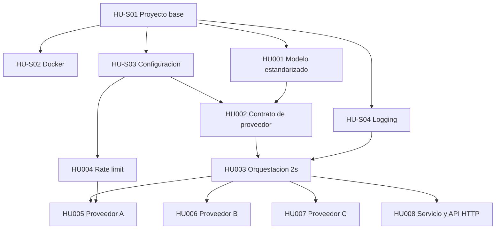

# Indice de Historias de Usuario

Constitucion del proyecto: [plan.md](../../plan.md). Plantilla de HU: [_template.md](_template.md).

Alcance de la fase 1: consulta paralela de disponibilidad y tarifas a los proveedores A, B y C con corte de 2 s y respuesta estandarizada. El punto de entrada es una **API HTTP construida con FastAPI** (HU008).

## Estados

- **Borrador**: redactada, pendiente de primera revision.
- **En revision**: en el loop de revision; tiene preguntas abiertas o decisiones pendientes.
- **Aprobada**: sin preguntas abiertas y con todas las decisiones de complejidad aprobadas manualmente.

## Historias

| ID | Titulo | Tipo | Estado | Version | Dependencias |
| --- | --- | --- | --- | --- | --- |
| [HU-S01](HU-S01-proyecto-base.md) | Proyecto base con uv y calidad de codigo | Setup | En revision | 0.3 | - |
| [HU-S02](HU-S02-docker.md) | Contenedor Docker | Setup | En revision | 0.3 | HU-S01 |
| [HU-S03](HU-S03-configuracion-proveedores.md) | Configuracion por proveedor | Setup | En revision | 0.2 | HU-S01 |
| [HU-S04](HU-S04-logging-trazabilidad.md) | Logging y trazabilidad | Setup | En revision | 0.2 | HU-S01 |
| [HU001](HU001-modelo-estandarizado.md) | Modelo estandarizado de consulta y respuesta | Funcional | En revision | 0.3 | HU-S01 |
| [HU002](HU002-contrato-proveedor.md) | Contrato comun de proveedor y registro | Funcional | En revision | 0.1 | HU001, HU-S03 |
| [HU003](HU003-orquestacion-paralela.md) | Orquestacion paralela con corte de 2 s | Funcional | En revision | 0.2 | HU002, HU-S04 |
| [HU004](HU004-rate-limit.md) | Rate limit configurable por proveedor | Funcional | En revision | 0.1 | HU-S03 |
| [HU005](HU005-proveedor-a.md) | Integracion proveedor A | Funcional | En revision | 0.2 | HU003, HU004 |
| [HU006](HU006-proveedor-b.md) | Integracion proveedor B | Funcional | En revision | 0.3 | HU003 |
| [HU007](HU007-proveedor-c.md) | Integracion proveedor C | Funcional | En revision | 0.3 | HU003 |
| [HU008](HU008-servicio-consulta-api.md) | Servicio de consulta y API HTTP | Funcional | En revision | 0.4 | HU001, HU003 |

## Dependencias

## Decisiones de complejidad pendientes de aprobacion

| HU | ID | Tema |
| --- | --- | --- |
| HU001 | DC-01 | Ordenamiento de resultados por precio final |
| HU003 | DC-01 | Modelo de concurrencia (asyncio + AsyncSession) |
| HU003 | DC-02 | Limite global de concurrencia para 1000+ proveedores |
| HU004 | DC-01 | Algoritmo de rate limit (token bucket) |
| HU004 | DC-02 | Politica al saturarse (descartar vs esperar) |
| HU006 | DC-01 | Estrategia de parseo de montos y fechas no estandar |
| HU006 | DC-02 | Recorrido del schema anidado de B |

## Loop de revision

1. Revisar una HU a la vez, en el orden de dependencias.
2. Responder sus preguntas abiertas y aprobar o rechazar sus decisiones de complejidad.
3. Registrar los cambios en el "Historial de revision" de la HU y subir la version (0.1 -> 0.2 ...).
4. Actualizar estado y version en este indice.
5. Una HU pasa a **Aprobada** solo cuando no le quedan preguntas abiertas ni decisiones pendientes.
